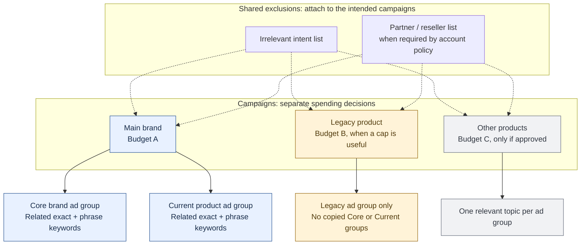

# Ads Account Operations

A reusable Codex skill for Google Ads and Yahoo JP Search audits, keyword discovery, budget-separated migrations and concise reporting, with Meta, GA4 and Search Console workflows.

Includes the operator's preferences: intent-level analysis, qualified conversion efficiency, deliberate budget control, approval boundaries and concise reports without em dashes. No client data, account IDs, credentials or private reporting links are included.

## The account structure

This is the target design for an authorized brand Search build or migration. Adapt it to the business; invoking the skill does not automatically create campaigns. Repeat the design separately for each platform.



Solid arrows show campaign contents. Dashed arrows show inherited shared exclusions. Budget amounts are account-specific; the letters are not a recommended allocation. Legacy and Other are optional, and unapproved campaigns stay paused.

Campaign-specific routing exclusions keep each budget focused on its intended topic. Direct ad-group negatives handle routing between groups inside a campaign. See the [routing diagram and worked example](ads-account-operations/references/account-design.md#negative-routing).

## Why this structure matters

- Campaigns answer **how much can this topic spend?** A separate legacy campaign lets the operator constrain old-product interest without applying the same limit to current brand demand. Campaign budgets can be individual or shared; a shared pool does not provide separate topic allocations. [Google budget guidance](https://support.google.com/google-ads/answer/2375454?hl=en).
- Ad groups answer **which topic and approved message should serve?** Keep related keywords together instead of rebuilding a SKAG for every spacing variant or match type.
- Negatives answer **where should this intent be excluded?** Common lists prevent repeated maintenance; campaign routing separates budget topics; group rules separate topics within a budget. Inspect the effective rules at every active group before declaring a gap.
- Topic-level reporting answers **which searches are worth funding?** Compare current-product, core and legacy spend and qualified actions separately. A campaign average can move simply because the traffic mix changed.
- Staged migration preserves a useful baseline and rollback. Copy only the intended entities, verify saved settings and ad eligibility, then switch traffic within the agreed combined budget. An enabled campaign can still be waiting for ad approval.

These are control and interpretability benefits, not a promise of lower CPA, incremental conversions or higher impression share.

## Opinionated defaults and why we chose them

These are defaults for focused brand capture, not universal rules for every advertiser. Current account instructions and explicit user choices take precedence. The [design notes](ads-account-operations/references/account-design.md#when-to-change-the-defaults) describe exceptions.

| Choice | Why we start here | Reconsider when |
| --- | --- | --- |
| Google Search Partners off | Keep the initial brand budget and measurements focused on Google Search inventory. Partner inventory is an additional reach decision, not an assumed part of the brief. [Network details](https://support.google.com/google-ads/answer/1722047?hl=en) | The user approves a measured expansion and qualified results support it |
| Display expansion off in Search | Avoid spending a demand-capture budget on website/app display inventory. [Display expansion](https://support.google.com/google-ads/answer/7193800?hl=en) | Display has its own approved objective and budget |
| AI Max / keywordless discovery off initially | Keep the initial campaign aligned with the reviewed keyword intent. Google AI Max and Yahoo query matching can extend reach beyond entered keywords. [Google](https://support.google.com/google-ads/answer/15910187?hl=en), [Yahoo](https://ads-help.yahoo-net.jp/s/article/H000064675?language=ja) | A bounded discovery test is approved and its queries will be reviewed |
| Automatic copy and final URL expansion off | Preserve approved claims, pins and landing-page choices. Google can generate text and select alternative URLs when those features are enabled. [Asset optimization](https://support.google.com/google-ads/answer/15910187?hl=en) | The user approves automated messaging/destinations and the tracking works |
| Topic ad groups with exact + phrase | Reduce duplicate structures and judge related intent together; inspect matched queries because match types are not strict literal walls | Different messages or landing pages genuinely require separate groups |
| Core and current product together initially | They share the current-brand objective. Split when a separate budget decision is useful, rather than because a keyword has a different name | A product needs a reserved allocation or distinct objective |
| Capture legacy intent with a separate cap when justified | Old names can retain useful intent, but their economics should not be hidden inside the main average | Legacy demand is negligible, or it performs well enough to share the main objective |
| Protect partners when the account policy requires it | A reseller search may be demand the business wants its partner to capture. Preserve that commercial decision | The user explicitly revises the partner strategy |
| Preserve bidding and approved creative during a move | Limit simultaneous changes so structural effects are easier to evaluate | A separately justified and authorized bidding/creative change is ready |
| Fresh readback and topic-level metrics before recommendations | Submitted forms, historical exports and blended CVRs do not establish the live state or the reason performance changed | This remains a verification standard, not an expansion feature |

No Search Partners, Display or AI feature is claimed to be inherently unprofitable. Their omission prioritizes scope, approvals and measurement for this workflow. No fixed bid strategy, CPC ceiling or legacy budget percentage is prescribed for all accounts.

## Search guidance and assets

The [Search strategy and assets reference](ads-account-operations/references/search-strategy-and-assets.md) covers STAG boundaries, brand versus generic objectives, responsive ads, pinning, useful assets, Google/Yahoo JP differences, sourced vendor averages and measurement. It preserves approval requirements and focused-brand defaults. Current official guidance is checked and dated, including Yahoo automatic quicklinks.

## Use

Copy `ads-account-operations` into your Codex skills directory, then invoke:

```text
Use $ads-account-operations to audit this account. Check keyword-topic
performance, effective negatives, active budgets and ad eligibility. Report only.
```

```text
Use $ads-account-operations to propose brand keywords from this Search Console
export, checking existing paid coverage and reseller exclusions.
```

```text
Use $ads-account-operations to stage a legacy-product campaign within our
existing budget. Copy only its group and preserve approved ads and assets.
```

Provide the account's timezone, currency, budget, topic boundaries, conversion definitions and permissions. Newer user directions and account instructions override the included defaults. The skill does not grant access or authorize account changes.

## Contents

- `SKILL.md`: workflow selection and essential decision rules.
- `references/`: operator preferences, account design, Search strategy/assets, account operations, reporting/discovery and offline checks.
- `scripts/audit_plan.py`: dependency-free local checks of normalized budget/routing snapshots.
- `scripts/test_audit_plan.py`: fictional regression scenarios.

The live synchronization script is not implemented yet. A [separate implementation prompt](ads-account-operations/references/live-sync-prompt.md) defines its scope, API adapters, ownership controls and verification requirements.

See [offline checks](ads-account-operations/references/offline-checks.md) for the input format. The helper does not connect to an ad platform. Passing it does not prove live matching or serving.

## Privacy

Keep account manifests, exports, keys and reporting destinations in a separate private workspace. Approval and publishing permissions remain task-specific. Test fixtures use fictional data.

## Validate

```sh
python3 ads-account-operations/scripts/test_audit_plan.py
```

The skill uses available authenticated tools or native browser reports. It contains no SDK, credential setup or autonomous bidding system.
