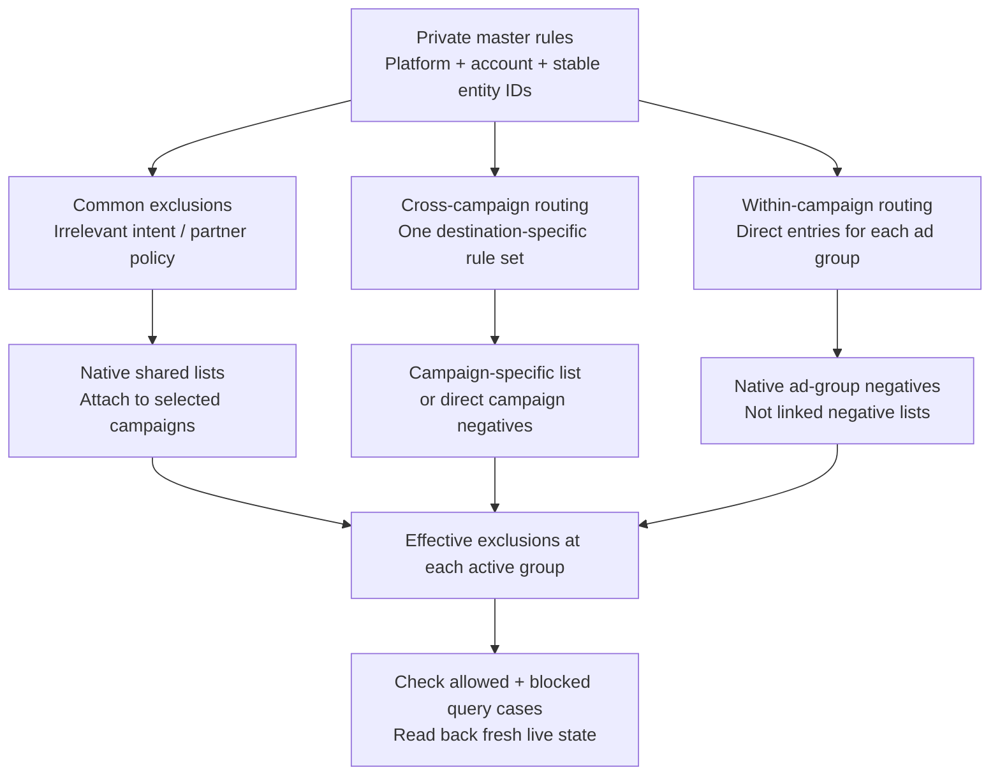

# Account design and rationale

The [repository overview](https://github.com/jonclemons/ads-account-operations-skill#the-account-structure) shows the target campaign tree. Use it as an adaptable design for authorized changes, not a command to split every existing account.

Campaigns own budget decisions; ad groups organize related intent, approved messages and destinations. A separate campaign is useful when its spending should be managed separately. A different spelling, match type or keyword alone is not that decision.

## Negative routing

This is the management model. The arrows do not mean the repository currently runs an automatic sync. It supplies an offline checker; the [live-sync implementation prompt](live-sync-prompt.md) defines the separate implementation.

Native shared lists attach to campaigns. Ad-group negatives are direct entries and need a separate managed process if they are to stay aligned with master rules. [Google negative scopes](https://support.google.com/google-ads/answer/7102995?hl=en), [Yahoo list and individual scopes](https://www.lycbiz.com/jp/news/yahoo-ads/20260122/).

### Which rules belong where?

| Purpose | Preferred owner | Example |
| --- | --- | --- |
| Intent irrelevant to all selected campaigns | Shared general list | Unrelated food searches for a travel brand, after checking actual intent |
| Partner policy common to those campaigns | Separate shared partner list | Approved reseller + brand combinations |
| Keep a topic out of an entire budget | Campaign-specific routing list or direct campaign entries | Legacy aliases excluded from Main |
| Keep two topics separate within one budget | Direct ad-group entries | Current-product name excluded from the Core group |

Do not place a legacy-name exclusion into a common list attached to the legacy campaign. A shared-list edit affects every attachment, including campaigns outside the current view. Inspect that wider scope before changing it.

Campaign-level exclusions are the preferred owner for a rule that should apply to the whole campaign. However, existing rules covering every active group may already achieve the desired behavior. Report that as working coverage; propose consolidation as maintenance, not as a nonexistent routing repair.

### Worked example

Fictional brand: Arbor. Current product: Nova. Legacy product: Classic. These are illustrative negative rules; they are not a complete account configuration or a platform match simulator.

| Destination | Campaign-level routing | Within-campaign group routing |
| --- | --- | --- |
| Main / Core | Exclude Classic aliases with appropriate phrase negatives | Exclude Nova intent from Core |
| Main / Nova | Inherits the same Classic exclusions | Exclude the bare Core query `[arbor]` where needed |
| Legacy / Classic | Exclude pure Core/current queries such as `[arbor]` and `[arbor nova]` | One group needs no duplicate internal routing layer |

The exact exclusions in Legacy are deliberate. A phrase negative `arbor` there would also exclude the legitimate `arbor classic` query.

| Representative query | Intended topic | Reason |
| --- | --- | --- |
| `arbor` | Main / Core | Pure brand intent |
| `arbor nova` | Main / Nova | Current product intent |
| `arbor classic prices` | Legacy / Classic | Explicit old-product interest |
| `arbor classic to nova` | Legacy / Classic in this example | Transition interest; Main excludes Classic, while Legacy's pure-current exact negative does not exclude the whole query |
| Partner name + `arbor` | Excluded if partner policy requires it | Commercial policy takes precedence over discovery |

Resolve mixed-topic queries explicitly. Do not add reciprocal phrase exclusions that leave a useful mixed query blocked in every campaign. Preserve platform-specific Japanese/English variants and test saved scope. Passing literal tests is not proof of live matching or positive keyword coverage.

## When to change the defaults

### Inventory and automated expansion

- Search Partners off is our starting choice for a Google Search brand brief. It restricts the inventory included in that budget; it is not evidence that partner conversions are poor. Reconsider with explicit approval and a comparison using the actual qualified conversion definitions. [Google Search Network](https://support.google.com/google-ads/answer/1722047?hl=en).
- Display expansion off preserves a Search-specific allocation. Display expansion can use predicted spare Search budget for display inventory, so it changes what the allocation buys. Use a separately approved Display objective when that is wanted. [Display expansion](https://support.google.com/google-ads/answer/7193800?hl=en).
- AI Max/search-term expansion off preserves an initially reviewed intent scope. AI Max can use broad and keywordless matching; Yahoo query matching can serve without an entered keyword. These can be useful discovery tools, but enable them only under an approved test with query review and spending controls. [Google AI Max](https://support.google.com/google-ads/answer/15910187?hl=en), [Yahoo query matching](https://ads-help.yahoo-net.jp/s/article/H000064675?language=ja).
- Automatic text and URL changes stay off when approved copy, pins and destinations are part of the contract. Google documents generated copy, alternative destinations and cases where URL expansion does not use pinned assets. These settings deserve a separate approval and tracking check. [Google asset optimization](https://support.google.com/google-ads/answer/15910187?hl=en).

Settings and product rollouts can change. Verify current controls on the actual platform; Google network switches do not automatically map to identical Yahoo controls. Do not assume a copied campaign or old paused shell has the intended defaults.

### Structure and commercial policy

Keep related exact/phrase keywords in one topic group and analyze their combined economics. This does not make exact match literal or phrase match perfectly constrained. Check the actual queries and avoid redundant spelling additions that merely duplicate existing coverage.

Keep Core and current product together until separate budget control is valuable. Isolate legacy or other products only when their objective, relevance or spending limit warrants it. Allocate using quality, coverage needs, spend and sales context, not conversion share alone. More campaigns do not create more demand.

Protect reseller searches when the business wants partners to capture them. Do not assume every account shares this policy, or promise that a low bid will always place an official ad below a partner.

Choose bidding from the account's goal definitions, evidence and approved coverage/cost tradeoff. Preserve the approved strategy during a structural move unless changing it is separately justified. Maximize Clicks, impression-share bidding, a fixed CPC ceiling and a fixed legacy budget percentage are not universal recommendations.

### Why verification remains part of the design

Use campaign totals for reconciliation, but assess efficiency within keyword topics and action types. Different topic or conversion mixes can change a blended rate without a uniform deterioration. Known PR and sales timing belong in that interpretation.

Stage migrations, retain original entities for rollback and re-read saved state. Do not claim copied history will automatically restore impressions. An enabled campaign with ads under review may not deliver. A planned allocation is not the live sum of active budgets, and daily budgets are not hard monthly spend caps.
